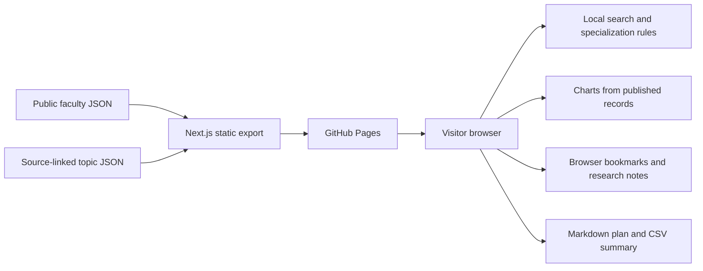

# Showcase architecture

Next.js statically exports the React website to `out/`. GitHub Pages serves HTML, CSS, JavaScript, and the supplied college crest. There are no runtime API calls or server processes.

`app/FacultyDirectory.tsx` imports the public faculty JSON directly. This fixes the previous failure when an API server was missing or out of date. `app/research-data.ts` owns shared data types, asset-prefix handling, search, and specialization-based suggestions. `ResearchOverview.tsx` derives its counts and distributions from the same published records. No figures are assigned to simulated users or invented outcomes.

`.github/workflows/pages.yml` installs locked dependencies, builds with `scripts/build-pages.mjs`, and publishes `out/` using the GitHub Pages deployment action. The build script infers the repository prefix from `GITHUB_REPOSITORY`. `.nojekyll` preserves Next.js asset directories. Asset paths use the same build-time prefix.

Notes and saved topics use versioned localStorage keys. Unavailable browser storage produces an explanatory message; downloads remain available. Public research topics have stable IDs so a user's saved list continues working after content updates.
